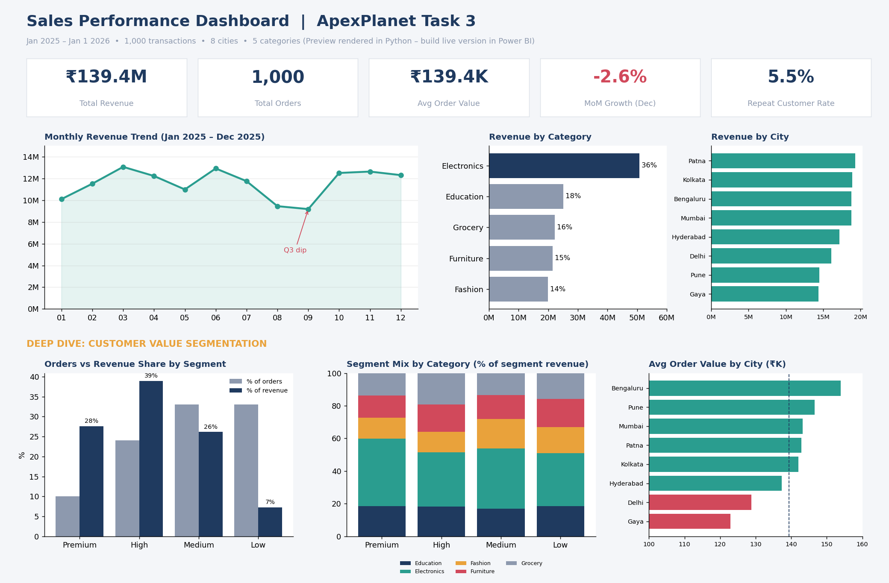
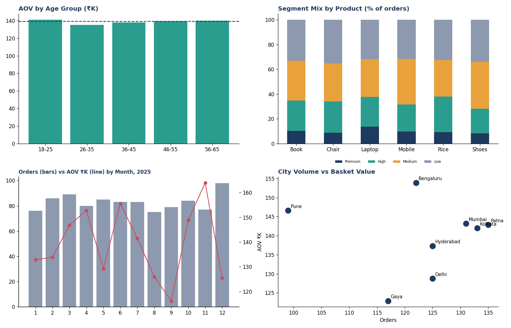

# ApexPlanet Task 3 – Deep-Dive Analysis & Interactive Dashboarding

**Internship:** ApexPlanet Software Pvt. Ltd. – Data Analytics
**Author:** [Your Name]  |  **Tools:** Python (pandas, matplotlib), Power BI, DAX, Excel

## Objective
Answer a multi-faceted business problem with a deep-dive analysis and an interactive, automated dashboard.

**Business question:** *Which order-value segments, products, cities and age groups drive revenue, and where is the biggest growth opportunity?*

## Task 3 requirements → where they are delivered
| Requirement | Deliverable |
|---|---|
| 1. Define 3–5 core KPIs with formulas and rationale | [`Documentation/KPI_Definitions.md`](Documentation/KPI_Definitions.md) |
| 2. Deep-dive analysis (Segmentation Analysis) | [`Documentation/Deep_Dive_Analysis.md`](Documentation/Deep_Dive_Analysis.md) |
| 3. Interactive dashboard (Power BI) | [`PowerBI/`](PowerBI/) – DAX, theme, build guide, `.pbix` |
| Deep-dive report on GitHub | This repository |
| Link to live dashboard | **[add link here after publishing]** |
| LinkedIn video (5–7 min) | **[add link here]** (outline in `PowerBI/Dashboard_Build_Guide.md`) |

## Dataset
`Dataset/ApexPlanet_DataAnalytics_Dataset.xlsx` – 1,000 sales transactions (1 Jan 2025 – 1 Jan 2026), 12 columns: Order, Customer, Age, Gender, City, Product, Category, Quantity, Unit_Price, Total_Sales.
`Dataset/Cleaned_Sales_Dataset.csv` – cleaned and enriched version used by the dashboard (adds segment, age group, month, flags). Cleaning steps are listed in the Deep-Dive document.

## Core KPIs
| KPI | Value |
|---|---|
| Total Revenue | ₹139.4M |
| Total Orders | 1,000 |
| Average Order Value | ₹139.4K |
| MoM Growth (Dec 2025) | −2.6% |
| Repeat Customer Rate | 5.5% |

## Headline findings
- **34% of orders generate 66.5% of revenue** (High + Premium segments).
- **Electronics** = 36.4% of revenue and 41.4% of Premium revenue.
- **Q3 slump** (Aug–Sep) about 16% below other quarters; October rebounds +36.2%.
- **Bengaluru** has the best basket value (₹153.9K); **Gaya** and **Delhi** the weakest.
- **94.5% of customers bought only once**, so retention is the largest opportunity.

Full detail: [`Documentation/Key_Findings.md`](Documentation/Key_Findings.md)

## Dashboard
| Page | Content |
|---|---|
| 1. Executive Overview | KPI cards, monthly trend, category and city revenue, slicers |
| 2. Customer Segmentation Deep Dive | Segment shares, category mix, city × category heat-map, AOV by city, decomposition tree |

Preview (layout reference): 

Deep-dive visuals: 

## Project structure
```
ApexPlanet-Task-3/
├── Dataset/
│   ├── ApexPlanet_DataAnalytics_Dataset.xlsx
│   └── Cleaned_Sales_Dataset.csv
├── PowerBI/
│   ├── Sales_Analysis_Dashboard.pbix   <- build with Dashboard_Build_Guide.md
│   ├── DAX_Measures.dax
│   ├── Task3_Theme.json
│   └── Dashboard_Build_Guide.md
├── Documentation/
│   ├── KPI_Definitions.md
│   ├── Deep_Dive_Analysis.md
│   └── Key_Findings.md
├── Screenshots/
└── README.md
```

## How to reproduce
1. Open Power BI Desktop and follow `PowerBI/Dashboard_Build_Guide.md`.
2. Load `Dataset/Cleaned_Sales_Dataset.csv`, apply `Task3_Theme.json`, add measures from `DAX_Measures.dax`.
3. Check your numbers against the QA table in the build guide.

## Limitations
Single year of data; almost all customers buy once; several fields are evenly distributed, so differences are directional rather than statistically proven (hypothesis testing follows in Task 4).

## Skills demonstrated
Data cleaning and validation · KPI design · Business-rule segmentation · DAX · Dashboard design · Data storytelling
